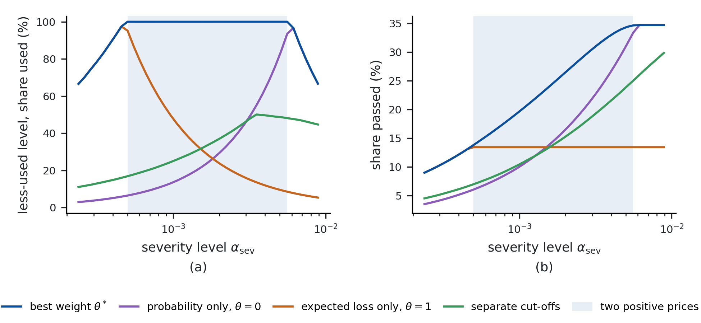

# Efficient Decision Rules under Multiple Risk Constraints

**Sung In (David) Cho** · Writing sample · [Paper (PDF)](paper/writing_sample.pdf) · [One-page summary](paper/summary.pdf)

---

## Research agenda

My research develops **efficient decision rules that integrate predictions with multiple risks and costs while maintaining reliability under changing conditions.**

| | Question | Status |
|---|---|---|
| **1. Efficiency under multiple risks** | When a decision must keep several risk limits at once, which risks must the rule combine, and how can it be set with few outcome labels so that every limit still holds? | **This paper** |
| **2. Reliability under changing conditions** | How can such a rule keep its limits when the cases it is calibrated on differ from the cases it decides? | **Next.** The paper isolates the two forms of this problem and states the question below. |

> **Next research question.** How can decision rules be calibrated to control multiple risks when policy-dependent selection makes the cases with observed outcomes differ from the population to which the rule is applied?

---

## This paper in brief

Predictive models increasingly decide which cases to pass automatically and which to hold back. For example, a lender approves some loan applications and sends the rest to review. Such deployments come with limits on **several risks at once**:
- how often adverse cases are passed,
- how much they cost once passed,
- how often other unwanted events occur.

Conformal methods can calibrate a rule so that several limits hold in finite samples. However, they take the **score** that ranks the cases as given. In practice that score usually ranks by a single risk, with other limits imposed by separate cut-offs. Such rules stop when one limit is reached and leave the others partly unused.

We study the problem

$$\max_{\phi}\ \mathbb{E}[\phi(X)] \quad \text{s.t.} \quad \mathbb{E}[\phi(X)\,\ell_k(X)] \le a_k,\qquad k=1,\dots,K,$$

whose solution passes the cases with $\sum_k \lambda_k \ell_k(x) < 1$ for prices $\lambda_k \ge 0$. This form follows from the generalized Neyman–Pearson lemma.

**Contributions**

1. **Which risks the score must combine.** Every linear score of the risks that leaves out a risk with a positive price passes strictly fewer cases. A risk with a zero price can be left out at no cost. For two risks, the prices can be read from the two standard single-risk rules.
2. **A procedure that spends labels only on calibration.** The prices, and with them the score's weights, are read from a plug-in linear program on new cases **without outcomes**. The cut-off is set by conformal risk control (CRC) for all constraints at once. Under exchangeability, each expected risk stays below its level in finite samples, for any estimates.
3. **Evidence.** The paper uses simulations with two and three risks and LendingClub loans with two risks. They show that combining risks pays exactly where the prices are positive, how much better estimates of each risk are worth, and when choosing the weights on outcome labels pays instead.

---

## What the paper answers, and what remains

| Answered | Not answered (yet) |
|---|---|
| Which risks the optimal score must combine: those with positive prices. Shown within linear scores, under a non-degeneracy condition. | Whether plug-in prices recover the true set of positive prices in general. In the experiments they did so in every repetition, but there is no theorem. |
| How to set the weights without labels and the cut-off with CRC, with a finite-sample guarantee in expectation under exchangeability. | A high-probability guarantee. Learn-then-test is the natural route. |
| When this beats weights chosen on labels: when labels are scarce, or (in simulation) when the estimates carry no systematic bias. | More than two risks on real data. The real-data evidence comes from one lender and from approved loans only. |
| How much better estimates are worth. In this design, errors in the probability of an adverse outcome cost more than errors in the loss. | **Temporal shift.** Calibrated on 2014 loans, every rule that uses a limit in full exceeds it in 2015, as risk rose. |
| | **Policy-dependent selection.** Outcomes exist only for cases a past rule passed. A guarantee on them does not carry over to all applicants. This is the next research question above. |

---

## Key results

| Setting | Finding |
|---|---|
| Two risks, simulation | Both prices are positive at 27 of 40 severity levels. There, the combined score passes **6.3 pp** more than the better single-risk score on average (up to 10.1 pp). Elsewhere it gains nothing. |
| Three risks, simulation | Where all three prices are positive, the combined score passes **3.5 pp** more than the best score that drops one risk on average (up to 8.0 pp). Where only two prices are positive, the gain is ≤ 0.012 pp. After calibration, all three limits hold. |
| Value of better estimates | In this design, noise and bias in $\hat p$ cost more than the same errors in $\hat c$. For example, noise of σ = 1 on the logit scale costs 8.9 pp for $\hat p$ against 2.3 pp for $\hat c$. |
| LendingClub, random split ($40 per applicant) | The plug-in prices pass **3.5 pp** more than the better single-risk score and 8.1 pp more than separate cut-offs, and both limits hold. |
| LendingClub, labels | Up to 10k labeled loans, plug-in prices win, because no labels are spent on the weights. From about 20k, weights chosen on labels win by 0.6–1.0 pp, because they correct an under-estimation bias in 2015. |
| LendingClub, temporal split | Calibrated on 2014 loans, the plug-in rule uses 116% of the coverage level and 136% of the severity level in 2015. |

<p align="center">
  <br>
  <em>Two risks (simulation). Shaded: severity levels at which both prices are positive. The combined score gains exactly there.</em>
</p>

---

## Repository layout

```
paper/
  writing_sample.pdf       the paper
  summary.pdf              one-page summary
src/
  simulation.py            all simulation experiments (two and three risks, value of estimates)
  prepare_lendingclub.py   LendingClub preprocessing: 36-month terminated loans, 2012–2015
  splits.py                train / validation / pre-2015 hold set / 2015 pool
  train_models.py          LightGBM models for p̂ and ĉ; predictions on the pool and hold set
  lc_data.py               shared constants and the U / calibration / test split of 2015 loans
  lendingclub.py           all LendingClub experiments
results/
  simulation/              figures and csv files of the simulations
  lendingclub/             figures and csv files of the LendingClub experiments
data/                      not tracked (see below)
```

---

## Reproducing the results

### Setup

```bash
pip install -r requirements.txt
```

### Simulations

No data needed. Outputs go to `results/simulation/`.

| Paper | Command | Output |
|---|---|---|
| Figure 1 | `python src/simulation.py levels` | `fig_levels.png`, `fig_levels.csv` |
| Figure 2 | `python src/simulation.py three --parts map` | `fig_three_map.png`, `three_map.csv` |
| Table 1, Figure 6 | `python src/simulation.py three --parts cal --reps 100` | `three_cal_summary.csv`, `fig_three_splits.png` |
| Figure 7 | `python src/simulation.py three --parts labels --reps 100` | `three_labels_summary.csv`, `fig_three_labels.png` |
| Figure 3 | `python src/simulation.py errors --reps 100` | `fig_errors.png`, `errors_summary.csv` |

### LendingClub

1. Download `accepted_2007_to_2018Q4.csv` from the [Kaggle LendingClub dataset](https://www.kaggle.com/datasets/wordsforthewise/lending-club) into `data/raw/`.
2. Build the data and fit the models:

```bash
python src/prepare_lendingclub.py --raw data/raw/accepted_2007_to_2018Q4.csv
python src/splits.py          # prints sizes, default rates and checks
python src/train_models.py    # writes data/processed/pool_preds.parquet and hold_preds.parquet
```

3. Run the experiments. Outputs go to `results/lendingclub/`.

| Paper | Command | Output |
|---|---|---|
| Figure 4, Table 2, Figure 8 | `python src/lendingclub.py table --n 100` | `fig_lc_levels.png`, `lc_table1.csv`, `fig_lc_splits.png` |
| Figure 5 | `python src/lendingclub.py labels --n 50` | `fig_lc_labels.png`, `lc_labels.csv` |
| Redraw figures | `python src/lendingclub.py figs` | from the saved csv files |
| Check | `python src/lendingclub.py check` | plug-in prices against an exact LP solver |

`table` takes about 10 minutes and `labels` about 5 minutes. Every LendingClub command takes `--main` (default `40`), the severity level in dollars per applicant used for Table 2.

---

## Main references

- Angelopoulos, Bates, Fisch, Lei, Schuster (2024). *Conformal risk control.* ICLR.
- Angelopoulos, Bates, Candès, Jordan, Lei (2025). *Learn then test: Calibrating predictive algorithms to achieve risk control.* Annals of Applied Statistics.
- Lehmann and Romano (2005). *Testing Statistical Hypotheses*, Theorem 3.6.1.
- Perdomo (2024). *The relative value of prediction in algorithmic decision making.* ICML.

The full list is in the paper.
